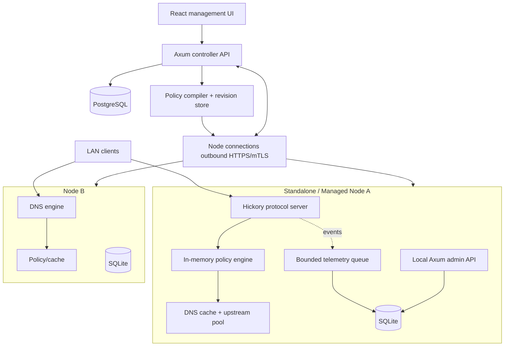

# Rust DNS Platform — Product Requirements, Architecture and Engineering Handoff

**Status:** Proposed v1 engineering baseline; blocking design decisions resolved, remaining items tracked in §13  
**Date:** 2026-11-03  
**Product name:** FerrixDNS
**CLI Command:** fx
**Deployment model:** Standalone edge nodes plus optional centralized management  
**Core stack:** Rust / Tokio / Axum / Hickory DNS / SQLx / SQLite / PostgreSQL; Vite / React / TypeScript / shadcn/ui / TanStack Router / TanStack Query  
**Scope:** Greenfield implementation inspired by Pi-hole's product capabilities, not a code translation.

---

## 1. Executive summary

Build an open-source, self-hostable, Rust-native DNS filtering and management platform that replaces the DNS, policy, telemetry, API and web administration layers of products such as Pi-hole. A standalone node is useful on day one: it resolves/forwards DNS, filters domains by configurable policies, serves an embedded admin UI, stores locally relevant data and survives Internet or controller outages. Multiple independent nodes can enroll in an optional centralized controller for inventory, hierarchical policies, versioned configuration deployment, aggregate analytics, access control and fleet operations.

**Non-negotiable architectural invariant:** the DNS serving path never synchronously depends on the central controller, the management API, query-history writes, or remote telemetry. Local persisted last-known-good configuration must restore service after reboot.

### 1.1 Product objectives

1. Reliable network-wide DNS forwarding and policy-based filtering on standard Linux hardware and small edge appliances.
2. Provide a modern, accessible, responsive management UI with investigative DNS analytics.
3. Enable centralized management and policy propagation without creating a single point of DNS availability failure.
4. Make security, auditable changes, privacy controls, and safe upgrades first-class features.
5. Keep an explicit architectural path to enterprise features, without forcing complexity onto standalone installations.

### 1.2 Target users and use cases

| Persona | Needs | Mode |
|---|---|---|
| Home administrator | Ad/tracker blocking, visual statistics, easy install | Standalone |
| Homelab operator | Container deployment, local DNS, split-horizon forwarding, API automation | Standalone or managed |
| IT administrator | Multi-site DNS, group policies, RBAC, change tracking | Managed |
| Security analyst | Investigate abnormal query patterns, export logs, investigate rule decisions | Managed |
| Platform operator | Health, upgrades, backups, fleet provisioning | Managed |

### 1.3 Scope and boundaries

**MVP (v0.1):** forwarding DNS over UDP/TCP, policy engine, subscribed blocklists, local overrides, allow/deny rules, client discovery by IP, SQLite, query events, responsive standalone UI, auth, config backup, native/container packaging.

**Production standalone (v1.0):** hardened cache, IPv4/IPv6, local authoritative zones, group policy, conditional forwarders, encrypted upstreams, DNSSEC options, robust observability and restore, migration/import tooling, documented operational processes.

**Managed fleet (v1.5):** node enrollment, mutual authentication, site/group hierarchy, policy compile/deploy/rollback, node inventory, fleet dashboards, RBAC, per-node and fleet telemetry, outage resilience, audit trail.

**Subsequent releases:** DHCPv4/v6 (explicit decision after DNS release), advanced detection/alerting, HA controller deployment, SaaS tenancy, external SIEM sinks, policy scheduling, automated node updates, full recursion only if separately validated.

**Out of scope initially:** endpoint agent, VPN, proxy/HTTPS interception, packet inspection, firewall, authoritative public Internet DNS hosting, DNS sinkholing by interception, commercial threat-intel feeds, endpoint attribution without reliable network identity, recursive resolver reimplementation.

## 2. Product requirements

Priority: P0 mandatory for initial production release; P1 managed release; P2 optional roadmap. Acceptance IDs map to verification tests.

| ID | Priority | Requirement | Acceptance criteria |
|---|---|---|---|
| FR-001 | P0 | Answer DNS UDP and TCP requests | Valid A, AAAA, CNAME, MX, TXT, PTR, SRV, HTTPS/SVCB and EDNS0 test cases pass against an authoritative upstream fixture |
| FR-002 | P0 | Forward via configurable upstream pools | Failover, timeouts, retries and routing are deterministic and logged |
| FR-003 | P0 | Fast filtering from memory | No SQL or HTTP dependency on query hot path |
| FR-004 | P0 | Exact allow/deny, suffix block, optional regex | Explicit precedence and group-scoped decisions tested |
| FR-005 | P0 | Blocklist subscriptions | HTTP conditional requests, limits, validation, compilation, atomic swap and error preservation; managed nodes receive lists only through signed bundles (§3.6) |
| FR-006 | P0 | Local DNS records | A, AAAA, CNAME, PTR support with anti-loop validation and defined authoritative behavior |
| FR-007 | P0 | DNS cache | TTL-aware positive/negative caching, bounded memory, policy-safe invalidation |
| FR-008 | P0 | Query history and counters | Selectable privacy mode, default full local history capped by age and bytes, bounded queue and rollups independent of response latency and of detailed-log drops |
| FR-009 | P0 | Web management | Authenticated UI for dashboard, queries, lists, rules, clients, upstreams and settings |
| FR-010 | P0 | Service continuity | Controller/UI/SQLite write failure cannot halt DNS service when configuration is already loaded |
| FR-011 | P0 | Backup/restore | Versioned configuration backup, secret handling, validation, recovery test |
| FR-012 | P0 | Local operator controls | CLI validate, health, diagnostics, recovery and reset-password workflows |
| FR-013 | P1 | Controller enrollment | One-time short-lived token; node-generated key; mTLS or cryptographically authenticated channel |
| FR-014 | P1 | Central policy versioning | Immutable policy revisions, signed site bundles, staging, validation, activation, acknowledgement, rollback |
| FR-015 | P1 | Multi-site hierarchy | Global, site, policy-group and client-specific policy assignments |
| FR-016 | P1 | Fleet inventory | Version, last seen, desired/applied bundle generation, list-artifact age, health and deployment state |
| FR-017 | P1 | Audit/RBAC | Scoped permissions, append-only audit trail, OIDC support |
| FR-018 | P1 | Aggregated telemetry | Rate-limited/batched delivery; independent on-node retention; controller deduplication |
| FR-019 | P1 | Controller outage recovery | Last known good policy survives controller outage and local reboot |
| FR-020 | P2 | DHCP | Network interface binding, lease safety, conflict detection, migration guidance |
| FR-021 | P2 | Automated updates | Signed binaries, maintenance windows, staged rollouts, rollback |

### 2.1 Nonfunctional requirements and initial SLO targets

These are **engineering targets, not measured capabilities**. Benchmark against representative hardware and workload before committing to a public SLO.

- **Availability:** DNS node target >=99.95% excluding host/network failures and maintenance. Controller availability does not define DNS availability.
- **Hot-path latency:** policy evaluation p99 <1 ms with warmed in-memory indexes on a defined midrange x86 test fixture; end-to-end cache hit p99 <5 ms under agreed load. Do not count network RTT in policy-engine benchmark.
- **Throughput:** sustain >=10,000 QPS/node on specified midrange x86 hardware under a defined mixed cache/blocked/upstream workload; optimize toward higher rates but avoid unqualified claims.
- **Memory:** configurable bounds for cache, compiled lists and telemetry. Validate on 1 GB RAM device; document reduced list/retention defaults.
- **Startup:** restore last valid policy and DNS availability without controller/network access, assuming available local upstreams or cache/local zones.
- **Durability:** persist committed config and policy snapshots with integrity verification, in storage isolated from query telemetry (§4.1); define SQLite checkpoint/backup schedule.
- **Security:** no unauthenticated mutations, no default credentials, admin API listen localhost by default, mutual authentication for remote management, no Internet-exposed recursive open resolver by default.
- **Privacy:** selectable query logging (full, anonymized, aggregate-only, disabled), per-client exclusions, local retention configuration, default minimal fleet exports. The standalone default is full local history, kept on the node for 7 days and disclosed in the setup wizard.
- **Portability:** Linux x86_64/aarch64 initial builds; Docker/Podman. Windows/macOS development support not a promise of production DNS-node support.
- **Accessibility:** WCAG 2.2 AA target for admin UI; keyboard navigation and screen-reader labels.

### 2.2 User journeys

**First install:** operator installs package; wizard binds DNS on selected interface, sets administrator identity, upstreams, filtering list and query-logging mode (default: full local history for 7 days, clearly disclosed), tests upstream reachability, shows how to set client/router DNS, and activates service.

**Investigate block:** operator filters query log by device/domain/time, inspects matching policy source and rule precedence, grants a temporary exception with reason/expiry and sees live effect without restarting DNS.

**Enroll node:** local admin generates enrollment request; controller issues one-time token for target site; node creates its own private key, establishes trust, gets desired revision; local DNS remains active throughout.

**Deploy central policy:** admin edits draft; dry-run evaluates sample domains and policy conflict checks; submits revision; selects rollout group; nodes independently validate/stage/activate; operator sees per-node results and can roll back.

**Controller unreachable:** node continues with last known good policy, upstreams, local records and local UI; retained event batches synchronize when connection resumes subject to privacy/quotas.

## 3. System architecture

### 3.1 Deployment topology



In standalone mode, the node embeds UI assets and serves an authenticated local Axum API; controller libraries are disabled. In managed mode the node preserves its local DNS, SQLite, local emergency admin, and optional read-only UI, while the controller owns designated managed fields. Ownership is explicit at the config-key level; local emergency overrides must be auditable and time bounded.

### 3.2 Process boundaries

**Node binary:** DNS listener/resolver + compiled policy + local persistent config + telemetry + local admin API + optional controller connectivity task. This enables simple packaging, but internally isolates tasks and failure domains. A crash in the process necessarily impacts DNS; use systemd restart and extensive fuzz/panic/error testing. Avoid `unwrap()` in packet paths.

**Controller binary:** API/UI, auth/RBAC, policy compilation and deployment workflow, fleet metadata, analytics ingestion and aggregation. Initially one Rust process backed by PostgreSQL; split workers only with measured need.

**No distributed consensus for nodes:** each node runs independently. Controller revisions are centrally ordered in PostgreSQL; DNS-serving nodes are not consensus participants.

### 3.3 Rust crates

```text
rust-dns-platform/
  Cargo.toml
  crates/
    dns-protocol/            # Hickory adapters, EDNS, wire handling
    dns-runtime/             # listeners, tasks, lifecycle, rate limits
    dns-upstreams/           # UDP/TCP/DoT/DoH forwarder and health
    dns-cache/               # bounded TTL and negative cache
    dns-policy/              # matcher, compilation, precedence, revisions
    dns-lists/               # source fetching, parsing, safety limits (used by standalone nodes and the controller)
    dns-local/               # authoritative local records and zones
    dns-identity/            # mapping client IP to known client and groups
    dns-telemetry/           # counters, event queue and rollups
    dns-storage/             # node config store, telemetry segments, snapshot files and migrations
    node-api/                # standalone REST/SSE/embedded static UI
    node-agent/              # controller enrollment and reconcile loop
    node-bin/                # CLI and node executable
    control-api/             # controller REST API, SSE, RBAC
    control-domain/          # sites, nodes, policies, bundles, list artifacts and rollouts
    control-storage/         # PostgreSQL repositories and migrations
    control-bin/             # controller executable
    shared-contracts/        # public DTOs, typed errors and identifiers
  frontend/
    src/routes/
    src/features/{overview,queries,clients,lists,rules,groups,upstreams,local-dns,nodes,sites,deployments,audit,settings}/
    src/components/ui/
    src/lib/api/
  migrations/{node-config,node-telemetry,control}/
  packaging/{systemd,docker,deb,rpm}/
  tests/{integration,interop,performance,fuzz-fixtures}/
  docs/{architecture,api,operations,adr}/
```

Crate dependencies flow inward: protocol/runtime adapters depend on domain interfaces; `dns-policy` and `shared-contracts` must not depend on Axum or a SQL implementation. Enforce with `cargo-deny`, linting and dependency-graph review.

### 3.4 DNS request lifecycle

1. Accept UDP/TCP message, enforce message size, rate and concurrency limits, parse with Hickory.
2. Validate opcode/class/questions/EDNS0, handle malformed and unsupported requests with standards-appropriate responses; never panic.
3. Resolve client identity from source address (potentially authenticated listener context). Do **not** trust arbitrary EDNS Client Subnet to assign security group. Define IPv6 and NAT limitations.
4. Select site/listener context, the client's applicable policy scopes (client, groups, site, global) and split-horizon routing context.
5. Evaluate policy against normalized IDNA/lowercase FQDN using immutable compiled snapshot. Names inside a managed local zone are evaluated against rules only, not subscribed lists.
6. If blocked, construct configured response (default configurable NXDOMAIN or zero-address; allow policy-specific behavior and document DNSSEC implications). Zero-address mode answers A with `0.0.0.0` and AAAA with `::`; other query types get an empty NOERROR answer. Negative block answers carry a synthetic SOA, and all block answers use a configurable TTL (default 60 seconds, maximum 86400). EDNS clients also receive Extended DNS Error 15 (Blocked, RFC 8914). If allowed and inside a managed local zone, answer from the local-zone record set. Otherwise check the upstream cache.
7. On a cache miss, select upstream pool by suffix/route, send query with bounded retries/deadlines; preserve request semantics, DNSSEC/EDNS behaviors, fallback to TCP after truncated UDP response.
8. Validate response/transaction provenance and cache only permitted records with TTL bounds and negative response handling.
9. For every cache hit or upstream answer, evaluate each CNAME target in the answer against the active snapshot. If any target is blocked, replace the answer with the configured block response. Chains deeper than 16 names return SERVFAIL. The cached upstream answer is left in place because it records no policy decision.
10. Return response; enqueue event non-blocking with separate monotonic timing and accurate result classification. Dropped event counter must increment.

**Precedence decision:** evaluation is scope-first, so the narrowest scope with a matching rule decides the outcome. The order is:

1. **Emergency deny, at any applicable scope.** This always wins, can be created only by privileged roles (§5.4) and is stored as `rules.is_emergency`.
2. **Client scope, then group scope, then site scope, then global scope.** The first scope containing any match decides. A client's groups are evaluated together as one scope.
3. **Within a scope, the first matching tier decides:** exact allow > suffix allow > regex allow > exact deny > suffix deny > subscribed allow > subscribed deny > regex deny.
4. **No match at any scope:** default allow.

For example, a client-scoped exact deny beats a global exact allow. Tiers carry a single action, so ties within a tier cannot change the outcome. The lowest rule ID or list source ID is recorded as the attribution, and overlaps are surfaced in the UI. There is no numeric rule priority. This ordering is platform-specific and not claimed to be Pi-hole-compatible. Tests must prove these choices.

**CNAME chains:** each CNAME target runs through the full evaluation above for the same client. If the query name itself matched an allow, whether from a rule or a subscribed allow, subscribed denies on its CNAME targets are ignored so the exception still works; rule denies and emergency denies on targets still block.

**Local zones:** subscribed lists never block names in a managed local zone, because an operator explicitly created those records. Rule denies and emergency denies do apply, so local zones cannot silently override explicit security denies.

**Policy/cache correctness:** a cached response must never escape new policy checks. Cache entries represent upstream answers only and never contain policy decisions, so a revision switch does not require a cache flush. Policy runs before the cache read for the query name (step 5) and after it for every CNAME target (step 9), including on cache hits. Cache entries should be partitioned by query name/type/class, upstream routing context, DNSSEC/CD/DO and ECS behavior as appropriate. Do not accidentally mix split-horizon answers.

**DNSSEC:** validate upstream response chains when enabled; do not blindly declare locally synthesized blocked answers DNSSEC-secure. Define AD bit, CD bit and SERVFAIL behavior with tests. A validating upstream alone is not equivalent to independent local validation.

**Local DNS:** distinguish a local authoritative zone from upstream forwarding; support RFC-compliant negative answers and TTLs, PTR generation where safe, SOA/NS ownership and CNAME conflict checks; forbid authoritative claims outside explicitly managed zones.

**Encrypted DNS:** initial upstream DoT/DoH uses TLS certificate validation, SNI and bootstrap IP configuration to avoid circular resolution. DoH inbound to clients is a later feature, independent of upstream DoH.

### 3.5 Policy compilation and hot swap

- Source definitions live in the node config store. Normalized list artifacts and compiled indexes are checksummed files in the node state directory (§4.1).
- Standalone nodes fetch lists themselves; in managed mode only the controller fetches them (§3.6).
- Fetch with SSRF protections (no loopback/private destinations by default unless explicitly permitted), response size/time limits and redirect limits.
- Parse hosts files, Adblock-style domain-only sources and plain-domain lists with explicit format selection; reject unsupported syntax and record invalid-line counts.
- Normalize IDNs, deduplicate, compile exact hashes and reversed-label suffix trie; regex compiled with Rust regex crate and bounded complexity; no arbitrary backtracking regex engine.
- Build immutable `PolicySnapshot {revision, checksum, list_layer, rule_overlay, metadata}` outside hot path; run conflict/size checks and dry-run corpus.
- The **list layer** holds compiled subscribed lists and is rebuilt only when list content or assignments change. The **rule overlay** holds rules, groups, client mappings and local exceptions, and must rebuild without recompiling lists so rule edits take effect promptly on large lists.
- A rule's `expires_at` is enforced by a timer that publishes a new overlay at the earliest expiry, so the hot path reads no clock for rule validity. Expiry does not create a config revision; it is recorded in the audit log. Overlay builds and boot both exclude rules that have already expired.
- Serialize a durable snapshot manifest; persist last known good; atomically publish via `arc-swap`-like primitive. Rollback swaps previous compiled revision after validation.
- On boot, load and verify the last-known-good snapshot before binding DNS listeners. Behavior when no valid snapshot exists is an open item (§13).
- Retain previous two known-good revisions plus manifest, subject to disk constraints.
- Every decision can optionally explain applied source, rule, scope, revision and precedence to UI without making decision tracing mandatory on every request.

### 3.6 Node/controller contract

- Nodes initiate connections to controller using outbound HTTPS and mTLS; no controller-initiated TCP access to LAN required.
- Enrollment: one-use token TTL <=10 minutes, claims node/site and allowed scope; node generates Ed25519 identity key or TLS keypair locally; controller issues bound certificate/identity; private keys never leave node.
- **Site bundles:** the unit a node receives and enforces is an immutable, signed per-site bundle, not a single policy revision. Its manifest pins `bundle_id`, `site_id`, a site-scoped monotonic `generation`, `schema_version`, the input policy revision IDs (global, site, group), the compiled policy document's SHA-256, every list artifact's SHA-256, issuer identity, signature, creation time and compatibility minimum. Nodes verify the signature over the exact stored manifest bytes, then verify each file against its pinned hash.
- **List distribution:** in managed mode the controller fetches, validates and versions list artifacts in a content-addressed store, and nodes do not contact list sources. Nodes pull artifacts by hash and prefer a delta from an artifact they already hold, falling back to a full download. Artifacts are signed through the manifest that pins their hash. The controller keeps every artifact referenced by a bundle that a node may still hold or roll back to.
- **Routine list refreshes:** a changed artifact runs through validation and dry-run corpus checks, then automatically creates a new bundle generation and a `list_refresh` deployment. These roll out with node-side jitter and no human approval. A guard holds the refresh for human approval when a site's change exceeds a configured ratio or the dry-run corpus reports newly blocked protected domains. Policy changes always use the full deployment workflow.
- **Controller outage:** nodes keep enforcing their last applied artifacts. List age is reported locally as a staleness warning and never invalidates active policy.
- Reconciliation: periodic desired-state check + long poll or outbound stream for prompt updates; jitter/backoff and retry budgets.
- Three-phase deploy: download/stage -> local validation/smoke tests -> atomic activate -> report applied checksum. Canaries, deadlines and automatic rollback based on node health checks.
- Controller records desired, staged and applied bundles separately. Partial rollout is a first-class state, not hidden as success.
- Remote outage: node never invalidates active policy on missing heartbeat, nor auto-clears local query data until retention limits apply.
- Certificates renew via authenticated flow; support manual recoverability and secure controller trust-anchor rotation.
- Reconnecting nodes reconcile by bundle generation and report their actual persisted applied generation; never assume packet delivery equals application. Nodes reject a generation lower than their applied one. A rollback is therefore a new, higher generation that pins older inputs. A node does not retry a generation it has reverted, and the controller reports that node as `reverted`.
- Fleet analytics use per-node event sequence + node ID for idempotency, batching, compression, backpressure and retention; default aggregates only, detailed logs opt-in.

## 4. Domain and storage model

### 4.1 Data separation

A node keeps three separate stores, so telemetry growth or corruption cannot block config commits or boot:

**Node config store (`config.db`, authoritative local):** config revisions, snapshot metadata, client identity mappings, rules/list source definitions, local zones, local audit events, controller enrollment data.

**Node snapshot files (state directory):** normalized list artifacts and compiled snapshots, stored as checksummed files by hash and published with write, fsync and atomic rename.

**Node telemetry store (`telemetry/`, disposable):** rollups in `rollups.db` and query events in daily segment files. If it is corrupt or unwritable, DNS keeps serving, the node reports degraded health, drop counters increment and the store is recreated.

**Local config model:** the active revision's document is authoritative. Tables such as `rules` and `list_sources` are projections of it, rewritten in the same transaction that activates a revision, so a rollback restores all of them together. In managed mode, controller-owned rows come from the applied bundle and rows with `origin = 'local'` hold time-bounded local exceptions, which survive bundle activation.

**Controller PostgreSQL (authoritative managed):** organizations (single-org initially), sites, nodes, policy groups, policy definitions, policy revisions, site bundles, list artifact metadata, deployments, users/roles, audit logs, aggregated node telemetry and node health. Artifact contents live in a content-addressed store, initially the controller's filesystem.

**Controller does not directly mutate node SQLite:** synchronization uses signed bundles and acknowledgments.

### 4.2 Canonical entities

- Organization → Site → Node, ClientGroup, Client.
- `PolicySet` and `PolicyRevision` (immutable) contain policies, list associations, DNS upstream/local DNS settings and schema compatibility.
- `Bundle` (immutable, signed, per site) pins a generation, the input policy revisions, the compiled policy document and list artifact hashes. It is what nodes receive and enforce.
- `Rule` contains pattern, action, match type, scope, origin, emergency flag, expiration, reason and enabled flag.
- `ListSource` contains URL, action (allow or deny), format, polling cadence, checksum, last status, update metadata and enable/disable state. A list with no group assignments applies at global scope.
- `ListArtifact` (controller, immutable) contains source, version, SHA-256, size, entry count and validation result.
- `Client` comprises stable assigned ID, observed addresses, optional hostname, group membership and identity provenance.
- `Deployment` and `DeploymentTarget` store kind, target bundle, node status, staging/activation timestamps and errors.
- `QueryEvent` stores timestamp, node, observed client, question, qtype, policy outcome, matched name, source rule or list and latency subject to privacy settings.
- `AuditEvent` stores actor, action, target, before/after hashes, reason and timestamp; never secrets or full token values.

### 4.3 Node SQLite DDL (reference subset)

Config store (`config.db`):

```sql
PRAGMA foreign_keys = ON;
PRAGMA journal_mode = WAL;
PRAGMA busy_timeout = 5000;

CREATE TABLE schema_migrations (
  version INTEGER PRIMARY KEY,
  applied_at TEXT NOT NULL
);
CREATE TABLE node_config_revisions (
  id TEXT PRIMARY KEY,
  parent_id TEXT,
  schema_version INTEGER NOT NULL,
  source TEXT NOT NULL CHECK(source IN ('local','controller','recovery')),
  sha256 TEXT NOT NULL,
  document_json TEXT NOT NULL,
  state TEXT NOT NULL CHECK(state IN ('staged','active','superseded','failed')),
  bundle_generation INTEGER,
  created_at TEXT NOT NULL,
  activated_at TEXT,
  FOREIGN KEY(parent_id) REFERENCES node_config_revisions(id)
);
CREATE UNIQUE INDEX idx_node_one_active_revision
  ON node_config_revisions(state) WHERE state='active';

CREATE TABLE client_groups (
  id TEXT PRIMARY KEY, name TEXT NOT NULL UNIQUE, description TEXT,
  enabled INTEGER NOT NULL DEFAULT 1 CHECK(enabled IN (0,1))
);
CREATE TABLE clients (
  id TEXT PRIMARY KEY, display_name TEXT, identity_source TEXT NOT NULL,
  enabled INTEGER NOT NULL DEFAULT 1, first_seen_at TEXT NOT NULL,
  last_seen_at TEXT
);
CREATE TABLE client_addresses (
  client_id TEXT NOT NULL REFERENCES clients(id) ON DELETE CASCADE,
  address TEXT NOT NULL, valid_from TEXT NOT NULL,
  valid_until TEXT, PRIMARY KEY(client_id,address,valid_from)
);
CREATE TABLE client_group_members (
  client_id TEXT NOT NULL REFERENCES clients(id) ON DELETE CASCADE,
  group_id TEXT NOT NULL REFERENCES client_groups(id) ON DELETE CASCADE,
  PRIMARY KEY(client_id,group_id)
);
CREATE TABLE rules (
  id TEXT PRIMARY KEY,
  action TEXT NOT NULL CHECK(action IN ('allow','deny')),
  match_type TEXT NOT NULL CHECK(match_type IN ('exact','suffix','regex')),
  pattern TEXT NOT NULL,
  scope_kind TEXT NOT NULL CHECK(scope_kind IN ('client','group','site','global')),
  scope_id TEXT,
  origin TEXT NOT NULL DEFAULT 'local' CHECK(origin IN ('local','controller')),
  is_emergency INTEGER NOT NULL DEFAULT 0 CHECK(is_emergency IN (0,1)),
  revision INTEGER NOT NULL DEFAULT 1,
  enabled INTEGER NOT NULL DEFAULT 1, expires_at TEXT,
  reason TEXT, created_at TEXT NOT NULL, updated_at TEXT NOT NULL,
  CHECK(is_emergency = 0 OR action = 'deny'),
  CHECK((scope_kind = 'global') = (scope_id IS NULL))
);
CREATE INDEX idx_rules_scope ON rules(scope_kind,scope_id,enabled);
CREATE TABLE list_sources (
  id TEXT PRIMARY KEY, url TEXT NOT NULL UNIQUE, format TEXT NOT NULL,
  action TEXT NOT NULL DEFAULT 'deny' CHECK(action IN ('allow','deny')),
  enabled INTEGER NOT NULL DEFAULT 1, refresh_seconds INTEGER NOT NULL,
  etag TEXT, last_modified TEXT, last_checked_at TEXT,
  last_good_sha256 TEXT, last_status TEXT,
  last_error TEXT, invalid_line_count INTEGER NOT NULL DEFAULT 0
);
CREATE TABLE list_group_members (
  list_id TEXT NOT NULL REFERENCES list_sources(id) ON DELETE CASCADE,
  group_id TEXT NOT NULL REFERENCES client_groups(id) ON DELETE CASCADE,
  PRIMARY KEY(list_id,group_id)
);
CREATE TABLE local_records (
  id TEXT PRIMARY KEY, zone_name TEXT NOT NULL, owner_name TEXT NOT NULL,
  rrtype TEXT NOT NULL, rdata TEXT NOT NULL,
  ttl_seconds INTEGER NOT NULL CHECK(ttl_seconds BETWEEN 0 AND 86400),
  UNIQUE(zone_name,owner_name,rrtype,rdata)
);
CREATE TABLE local_audit_events (
  id TEXT PRIMARY KEY, occurred_at TEXT NOT NULL, actor TEXT NOT NULL,
  action TEXT NOT NULL, target TEXT NOT NULL, details_json TEXT NOT NULL
);
```

Telemetry rollups (`telemetry/rollups.db`):

```sql
CREATE TABLE telemetry_meta (
  key TEXT PRIMARY KEY, value TEXT NOT NULL
);
CREATE TABLE query_rollups_1m (
  bucket_start TEXT NOT NULL, client_id TEXT NOT NULL DEFAULT '',
  outcome TEXT NOT NULL, qtype TEXT NOT NULL,
  count INTEGER NOT NULL DEFAULT 0, latency_sum_us INTEGER NOT NULL DEFAULT 0,
  PRIMARY KEY(bucket_start,client_id,outcome,qtype)
);
```

Query event segment (`telemetry/queries-YYYY-MM-DD.db`, one per UTC day):

```sql
CREATE TABLE query_events (
  seq INTEGER PRIMARY KEY,
  occurred_at TEXT NOT NULL, client_id TEXT, client_ip TEXT,
  qname TEXT, matched_name TEXT, qtype TEXT NOT NULL, outcome TEXT NOT NULL,
  rcode TEXT NOT NULL, rule_id TEXT, source_list_id TEXT, upstream_id TEXT,
  duration_us INTEGER NOT NULL, revision_id TEXT
);
CREATE INDEX idx_query_time ON query_events(occurred_at DESC,seq DESC);
CREATE INDEX idx_query_client_time ON query_events(client_id,occurred_at DESC);
CREATE INDEX idx_query_name_time ON query_events(qname,occurred_at DESC);
```

Note: query log columns may be NULL depending on privacy policy; schema alone does not anonymize data. `matched_name` differs from `qname` when a CNAME target was the name blocked. The telemetry writer assigns `seq` so it stays monotonic across segments, persisting its high-water mark in `telemetry_meta`. `client_id`, `rule_id` and `source_list_id` are soft references because they cross database files. Addresses are stored in canonical validated textual format, and `client_addresses` requires application-level overlap/identity checks. Create database migrations rather than executing ad hoc DDL on boot.

### 4.4 Controller PostgreSQL DDL (reference subset)

```sql
CREATE EXTENSION IF NOT EXISTS pgcrypto;
CREATE TABLE organizations (
  id uuid PRIMARY KEY DEFAULT gen_random_uuid(),
  name text NOT NULL, created_at timestamptz NOT NULL DEFAULT now()
);
CREATE TABLE sites (
  id uuid PRIMARY KEY DEFAULT gen_random_uuid(),
  org_id uuid NOT NULL REFERENCES organizations(id),
  name text NOT NULL, timezone text NOT NULL DEFAULT 'UTC',
  UNIQUE(org_id,name), UNIQUE(org_id,id)
);
CREATE TABLE nodes (
  id uuid PRIMARY KEY DEFAULT gen_random_uuid(),
  org_id uuid NOT NULL REFERENCES organizations(id),
  site_id uuid NOT NULL, display_name text NOT NULL,
  identity_fingerprint text NOT NULL UNIQUE, software_version text,
  desired_bundle_id uuid, applied_bundle_id uuid,
  last_seen_at timestamptz, enrolled_at timestamptz NOT NULL DEFAULT now(),
  disabled_at timestamptz,
  FOREIGN KEY(org_id,site_id) REFERENCES sites(org_id,id),
  UNIQUE(org_id,id)
);
CREATE TABLE policy_sets (
  id uuid PRIMARY KEY DEFAULT gen_random_uuid(),
  org_id uuid NOT NULL REFERENCES organizations(id),
  name text NOT NULL, scope_kind text NOT NULL,
  scope_id uuid, created_at timestamptz NOT NULL DEFAULT now(),
  UNIQUE(org_id,name)
);
CREATE TABLE policy_revisions (
  id uuid PRIMARY KEY DEFAULT gen_random_uuid(),
  policy_set_id uuid NOT NULL REFERENCES policy_sets(id),
  revision_number bigint NOT NULL, schema_version integer NOT NULL,
  document jsonb NOT NULL, checksum_sha256 text NOT NULL,
  created_by uuid,
  created_at timestamptz NOT NULL DEFAULT now(),
  UNIQUE(policy_set_id,revision_number)
);
CREATE TABLE list_sources (
  id uuid PRIMARY KEY DEFAULT gen_random_uuid(),
  org_id uuid NOT NULL REFERENCES organizations(id),
  url text NOT NULL, format text NOT NULL,
  action text NOT NULL DEFAULT 'deny' CHECK(action IN ('allow','deny')),
  enabled boolean NOT NULL DEFAULT true, refresh_seconds integer NOT NULL,
  UNIQUE(org_id,url)
);
CREATE TABLE list_artifacts (
  id uuid PRIMARY KEY DEFAULT gen_random_uuid(),
  list_source_id uuid NOT NULL REFERENCES list_sources(id),
  version bigint NOT NULL, sha256 text NOT NULL,
  byte_size bigint NOT NULL, entry_count bigint NOT NULL,
  validation_status text NOT NULL,
  created_at timestamptz NOT NULL DEFAULT now(),
  UNIQUE(list_source_id,version), UNIQUE(list_source_id,sha256)
);
CREATE TABLE list_artifact_deltas (
  from_artifact_id uuid NOT NULL REFERENCES list_artifacts(id),
  to_artifact_id uuid NOT NULL REFERENCES list_artifacts(id),
  sha256 text NOT NULL, byte_size bigint NOT NULL,
  PRIMARY KEY(from_artifact_id,to_artifact_id)
);
-- manifest holds the exact signed bytes; jsonb would not preserve them.
CREATE TABLE bundles (
  id uuid PRIMARY KEY DEFAULT gen_random_uuid(),
  org_id uuid NOT NULL REFERENCES organizations(id),
  site_id uuid NOT NULL, generation bigint NOT NULL,
  schema_version integer NOT NULL, manifest bytea NOT NULL,
  manifest_sha256 text NOT NULL, signature bytea NOT NULL,
  created_at timestamptz NOT NULL DEFAULT now(),
  FOREIGN KEY(org_id,site_id) REFERENCES sites(org_id,id),
  UNIQUE(site_id,generation)
);
CREATE TABLE bundle_policy_revisions (
  bundle_id uuid NOT NULL REFERENCES bundles(id),
  policy_revision_id uuid NOT NULL REFERENCES policy_revisions(id),
  PRIMARY KEY(bundle_id,policy_revision_id)
);
CREATE TABLE bundle_list_artifacts (
  bundle_id uuid NOT NULL REFERENCES bundles(id),
  list_artifact_id uuid NOT NULL REFERENCES list_artifacts(id),
  PRIMARY KEY(bundle_id,list_artifact_id)
);
CREATE TABLE deployments (
  id uuid PRIMARY KEY DEFAULT gen_random_uuid(),
  org_id uuid NOT NULL REFERENCES organizations(id),
  kind text NOT NULL CHECK(kind IN ('policy','list_refresh','rollback')),
  policy_revision_id uuid REFERENCES policy_revisions(id),
  requested_by uuid, strategy jsonb NOT NULL,
  status text NOT NULL, created_at timestamptz NOT NULL DEFAULT now(),
  completed_at timestamptz,
  CHECK(kind <> 'policy' OR policy_revision_id IS NOT NULL)
);
CREATE TABLE deployment_targets (
  deployment_id uuid NOT NULL REFERENCES deployments(id),
  node_id uuid NOT NULL REFERENCES nodes(id),
  bundle_id uuid NOT NULL REFERENCES bundles(id),
  status text NOT NULL, staged_at timestamptz,
  activated_at timestamptz, last_error_code text,
  last_error_message text, applied_checksum text,
  PRIMARY KEY(deployment_id,node_id)
);
CREATE TABLE node_telemetry_batches (
  node_id uuid NOT NULL REFERENCES nodes(id),
  first_seq bigint NOT NULL, last_seq bigint NOT NULL,
  received_at timestamptz NOT NULL DEFAULT now(),
  PRIMARY KEY(node_id,first_seq)
);
CREATE TABLE audit_events (
  id uuid PRIMARY KEY DEFAULT gen_random_uuid(),
  org_id uuid NOT NULL REFERENCES organizations(id),
  actor_kind text NOT NULL, actor_id text NOT NULL,
  event_type text NOT NULL, resource_type text NOT NULL,
  resource_id text NOT NULL, details jsonb NOT NULL,
  occurred_at timestamptz NOT NULL DEFAULT now()
);
CREATE INDEX idx_nodes_org_site ON nodes(org_id,site_id);
CREATE INDEX idx_audit_org_time ON audit_events(org_id,occurred_at DESC);
```

**Critical migration note:** the DDL above is an illustrative core, not the entire production migration set. Add `nodes.desired_bundle_id` and `applied_bundle_id` foreign keys after both tables exist, plus org-scoped FK constraints for deployment, bundle, list and policy references. Full schema requires `identities`, `roles`, `role_bindings`, `api_tokens`, `enrollment_tokens` (hashed), `node_certificates`, `policy_rules`, `policy_groups`, `client_assignments`, `upstream_pools`, `local_zones`, `aggregates_1m/1h`, `alerts`, `secret_references`, and outbox tables. Application and DB policies must enforce tenant boundaries on every join; consider PostgreSQL RLS as defense in depth once multiple organizations are enabled.

### 4.5 Data retention and indexing

Default local full query history: 7 days, capped at 2 GiB; local rollups: 90 days; aggregated managed fleet metrics: 90 days; managed detailed query events disabled until opted in. These defaults are product proposals.

**Query history volume:** whichever cap is reached first applies. Retention deletes whole segment files, oldest first, so pruning needs no large `DELETE`, and the UI shows the window actually retained. At an assumed 150 bytes per event including indexes (to be measured in Phase 2), 2 GiB holds about 14 million events: about 7 days at 24 QPS on average, or about 24 minutes at 10,000 QPS. High-traffic nodes must raise the cap, shorten retention or use a reduced logging mode. `max_event_queue = 50000` covers only about 5 seconds of a stalled writer at 10,000 QPS, so detailed events are shed with `dns_telemetry_dropped_total` incrementing. Rollup counters are updated in memory before the event queue, so counts stay accurate when detail is dropped.

Index by node + time and common filters; use keyset pagination (`occurred_at`, `seq`) to avoid expensive high-offset queries. Restrict search windows and query result caps. For large managed fleets, use PostgreSQL monthly/daily time partitions, optionally offload aggregated metrics to a time-series store after workload justifies it. Do not introduce ClickHouse/Timescale before observing need.

## 5. API design and contracts

### 5.1 Standards

- API prefix `/api/v1`; OpenAPI 3.1 specification produced from DTO/schema declarations; generate TypeScript types/client from it.
- `application/json`; UTC ISO 8601 timestamps, UUID/ULID opaque identifiers, canonical FQDN representation, stable error codes.
- Cursor pagination (`limit` 1-200, `cursor` opaque); filter by time window; sorted descending by timestamp and sequence.
- Idempotency-Key header required for enrollment, deployment creation and other replay-sensitive mutations.
- `ETag`/`If-Match` on editable resources to reject stale writes (HTTP 412).
- Asynchronous long operations return `202 Accepted` and job/deployment ID rather than holding HTTP request open.
- Error envelope: `{ "error": { "code": "RULE_INVALID", "message": "...", "details": {...}, "request_id": "..." } }`.
- Local browser auth: secure HttpOnly SameSite cookie, CSRF protection, Argon2id passwords. API tokens have scopes, expiry and rotation. Central OIDC uses authorization code + PKCE.
- SSE for UI event streaming with authenticated sessions and reconnect event IDs; do not silently expose query logs through unauthenticated EventSource endpoints.

### 5.2 Standalone node HTTP API

| Method | Endpoint | Notes |
|---|---|---|
| GET | `/api/v1/health/live` | Minimal process liveness; no private details |
| GET | `/api/v1/health/ready` | Auth or restricted access; DNS listener and config status |
| GET | `/api/v1/overview?from=&to=` | Counters and rate buckets |
| GET | `/api/v1/queries` | Cursor, qname, client, action, qtype, time filters |
| GET | `/api/v1/queries/stream` | SSE live query events |
| GET/POST | `/api/v1/rules` | Enumerate/create scoped rules; creating activates a new config revision |
| GET/PATCH/DELETE | `/api/v1/rules/{id}` | Optimistic concurrency; changes activate a new config revision |
| POST | `/api/v1/rules/test` | Explain expected decision for domain/client |
| GET/POST | `/api/v1/lists` | Source CRUD |
| POST | `/api/v1/lists/{id}/refresh` | Async job |
| GET | `/api/v1/jobs/{id}` | Refresh/compile progress |
| GET/POST | `/api/v1/clients` | Client inventory and manual identity |
| PATCH | `/api/v1/clients/{id}` | Labels/groups/privacy settings |
| GET/POST | `/api/v1/groups` | Group management |
| GET/PUT | `/api/v1/dns/upstreams` | Upstream pools and routing |
| GET/POST | `/api/v1/dns/records` | Local DNS |
| GET | `/api/v1/config/revisions` | Revision history |
| POST | `/api/v1/config/validate` | Dry-run config validation |
| POST | `/api/v1/config/activate` | Roll back or restore: copies an earlier revision forward as a new active revision |
| POST | `/api/v1/backup` | Create portable backup |
| GET | `/api/v1/system/metrics` | Authenticated metrics summary |
| GET | `/api/v1/auth/session` | Current user permissions |

**Mutation semantics:** there are no local drafts. Each successful configuration write validates the change, commits a new config revision, rewrites its table projections and publishes a new rule overlay before returning, so a success response means the change is active on that node. Each resource's `revision` is an integer used for `ETag`/`If-Match`; `config_revision_id` identifies the node-wide revision. List content changes return `202 Accepted` and a job ID because the list layer must recompile. In managed mode, controller-owned fields are read-only locally, and local writes are limited to time-bounded exceptions and break-glass recovery.

Example request:

```http
POST /api/v1/rules
Content-Type: application/json
Idempotency-Key: a41fc69f-681f-49fe-82d6-55c874c1f5e7

{
  "action": "deny",
  "match_type": "suffix",
  "pattern": "tracking.example",
  "scope": {"kind": "group", "id": "01J8GROUPEXAMPLE"},
  "enabled": true,
  "reason": "Security policy",
  "expires_at": null
}
```

Example response `201 Created`:

```json
{
  "data": {
    "id": "01J8RULEEXAMPLE",
    "action": "deny",
    "match_type": "suffix",
    "pattern": "tracking.example",
    "scope": {"kind": "group", "id": "01J8GROUPEXAMPLE"},
    "enabled": true,
    "revision": 1,
    "config_revision_id": "01J8REV",
    "created_at": "2026-11-03T20:00:00Z"
  }
}
```

Rule `suffix` matches the apex and strict subdomain suffix at DNS label boundaries; `example.com` must not match `notexample.com`. Distinguish `*.`-style strict subdomain match if added later. API schema validation must constrain qname length, IDNA encoding, regex size, timestamps and assignment scope.

Example query response:

```json
{
  "data": [
    {
      "id": "node-1:123456",
      "occurred_at": "2026-11-03T20:00:00.100Z",
      "client": {"id": "01J8CLIENT", "address": "192.168.1.20"},
      "question": {"name": "ads.example", "type": "A"},
      "decision": {"action": "blocked", "source": "subscribed_list", "source_list_id": "01J8LIST", "rule_id": null, "matched_name": "ads.example"},
      "rcode": "NXDOMAIN", "duration_us": 310,
      "revision_id": "01J8REV"
    }
  ],
  "page": {"next_cursor": null, "has_more": false}
}
```

### 5.3 Controller administrative API

| Method | Endpoint | Purpose |
|---|---|---|
| GET/POST | `/api/v1/sites` | Site inventory |
| GET/POST | `/api/v1/nodes` | Node inventory and logical registration |
| GET | `/api/v1/nodes/{id}` | Health, revision, config ownership |
| POST | `/api/v1/enrollment-tokens` | One-time scoped enrollment grant |
| POST | `/api/v1/policy-sets` | New policy set |
| GET/POST | `/api/v1/policy-sets/{id}/revisions` | Immutable revisions |
| POST | `/api/v1/policy-sets/{id}/validate` | Preflight |
| GET/POST | `/api/v1/list-sources` | Central list sources and refresh cadence |
| GET | `/api/v1/list-artifacts` | Artifact versions, validation results and held refreshes |
| POST | `/api/v1/list-artifacts/{id}/approve` | Release a refresh held by a guard |
| POST | `/api/v1/deployments` | Canary/wave rollout; builds a new bundle for each target site |
| GET | `/api/v1/deployments/{id}` | Per-node progress |
| POST | `/api/v1/deployments/{id}/rollback` | New rollback deployment at a higher bundle generation |
| GET | `/api/v1/analytics/overview` | Aggregated fleet metrics |
| GET | `/api/v1/audit-events` | Scoped audit query |
| GET/POST | `/api/v1/access/role-bindings` | RBAC administration |

Enrollment and node reconciliation are separate from browser admin API:

| Method | Endpoint | Auth |
|---|---|---|
| POST | `/node/v1/enroll` | One-time token + proof of node key possession |
| POST | `/node/v1/heartbeat` | Node certificate |
| GET | `/node/v1/desired-state` | Node certificate, ETag; returns the desired bundle ID and generation |
| GET | `/node/v1/bundles/{id}` | Node certificate; returns exact signed manifest bytes and signature |
| GET | `/node/v1/artifacts/{sha256}` | Node certificate; compiled policy document or full list artifact, resumable |
| GET | `/node/v1/artifacts/{sha256}/delta?from={sha256}` | Node certificate; `404` means fall back to full download |
| POST | `/node/v1/bundles/{id}/ack` | Node certificate, idempotent; reports applied generation and checksum |
| POST | `/node/v1/telemetry/batches` | Node certificate, dedup sequence |
| POST | `/node/v1/certificates/rotate` | Current authenticated node identity |

Example deployment request:

```json
{
  "policy_revision_id": "7a4b1af1-37ce-490b-9650-bba07e94c71e",
  "target": {"site_ids": ["36f91bba-af45-4910-b4ae-38a3af6e40a4"]},
  "strategy": {
    "kind": "canary_waves",
    "canary_count": 1,
    "wave_size": 5,
    "max_failed_nodes": 0,
    "pause_seconds_between_waves": 120,
    "rollback_on_node_health_failure": true
  },
  "reason": "Deploy updated site policy"
}
```

Response `202 Accepted` includes deployment ID and status URL. Deployment `kind` is `policy`, `list_refresh` or `rollback`; `list_refresh` deployments are created by the controller, not through this endpoint (§3.6). `status` transitions: `queued -> staging -> canary -> rolling_out -> succeeded | partially_failed | failed | rolled_back | cancelled`. Per-node states: `pending -> downloading -> staged -> activating -> healthy | failed | reverted`; timeouts and disconnected nodes explicitly reported.

### 5.4 Authorization matrix

| Capability | Viewer | DNS Operator | Policy Admin | Fleet Admin | Security Auditor |
|---|---:|---:|---:|---:|---:|
| View dashboards | Yes | Yes | Yes | Yes | Yes |
| View detailed query logs | Scoped | Scoped | Scoped | Scoped | Scoped |
| Create local exception | No | Scoped | Yes | Yes | No |
| Create emergency deny | No | No | Scoped | Yes | No |
| Approve held list refresh | No | No | Scoped | Yes | No |
| Edit global policy | No | No | Yes | Yes | No |
| Deploy revision | No | No | Scoped | Yes | No |
| Enroll/remove nodes | No | No | No | Yes | No |
| Manage identities | No | No | No | Yes | No |
| View audit events | No | No | Scoped | Yes | Yes |

Use deny-by-default authorization checks in domain services, not only UI route guards. Enforce site and organization restrictions on every object access. Break-glass local admin access is limited, separately logged, and may temporarily override managed restrictions only within explicit guardrails.

## 6. Frontend specification

### 6.1 Stack

- Vite + React + TypeScript strict mode.
- Tailwind CSS and shadcn/ui; theme tokens, light/dark/system modes.
- TanStack Router file-based route tree (`@tanstack/router-plugin` before React Vite plugin).
- TanStack Query for typed server state, invalidations, optimistic edits where reversible.
- TanStack Table + virtualized rows for high-volume query logs.
- Recharts for time series; avoid sending raw 100k query events to chart components.
- React Hook Form + Zod; OpenAPI-generated TypeScript wire types and Zod schemas if compatible.
- Lucide icons, date-fns, Sonner notifications, accessible dialogs, code-split routes.

### 6.2 Navigation and pages

**Standalone navigation:** Overview, Query Explorer, Clients, Filtering (Rules / Sources), Groups, DNS (Upstreams / Local Records / Cache), Analytics, System (Health / Updates / Backups), Settings, Help.

**Managed navigation:** Fleet Overview, Sites, Nodes, Policies (Global/Site/Groups), Deployments, Query Analytics, Audit, Access, Settings. Node context provides the same familiar DNS and query tools within the assigned site.

| Route | Main interactions | Primary data |
|---|---|---|
| `/` | Summary cards, traffic graph, health and top clients | `/overview` |
| `/queries` | Time range, client, qname, status, qtype, cursor, inspect decision | `/queries` + SSE |
| `/clients` | Identify device, set alias, assign groups, privacy mode | `/clients` |
| `/filtering/rules` | Add/edit/test/expire rule, detect conflicts | `/rules` |
| `/filtering/lists` | Add source, refresh, show status/invalid entries | `/lists` |
| `/groups` | Group membership and effective policy | `/groups` |
| `/dns/upstreams` | Forwarder pools, routing, health test | `/dns/upstreams` |
| `/dns/records` | Local zones and records editor | `/dns/records` |
| `/system` | Node diagnostics and backup | `/system/*` |
| `/fleet/nodes` | Inventory, health and desired/applied version | `/nodes` |
| `/fleet/sites` | Site configs and assignment | `/sites` |
| `/policies` | Revision editor, diff, simulation, publish | `/policy-sets` |
| `/deployments` | Rollout grid, canary, errors, rollback and held list refreshes | `/deployments`, `/list-artifacts` |
| `/audit` | Structured event search and export | `/audit-events` |
| `/access` | OIDC mapping, roles and site grants | `/access/*` |

File-based route plan:

```text
frontend/src/routes/
  __root.tsx
  login.tsx
  _authenticated.tsx
  _authenticated.index.tsx
  _authenticated.queries.tsx
  _authenticated.clients.tsx
  _authenticated.filtering.rules.tsx
  _authenticated.filtering.lists.tsx
  _authenticated.groups.tsx
  _authenticated.dns.upstreams.tsx
  _authenticated.dns.records.tsx
  _authenticated.analytics.tsx
  _authenticated.system.tsx
  _authenticated.settings.tsx
  _authenticated.fleet.nodes.tsx
  _authenticated.fleet.nodes.$nodeId.tsx
  _authenticated.fleet.sites.tsx
  _authenticated.policies.tsx
  _authenticated.deployments.tsx
  _authenticated.audit.tsx
  _authenticated.access.tsx
```

Routes unavailable in standalone mode are removed from navigation and guarded by capability-based checks. Never assume hidden navigation provides authorization.

### 6.3 UI design tokens and layout

- Collapsible left sidebar (240px expanded; 64px icon rail); fixed top action/identity bar.
- Content max width 1600px; dense tables with whitespace in detail views.
- Neutral surfaces; semantic success/warning/danger; avoid making status distinguishable by color alone.
- Operational cards with exact data interval and unit; explicit `last updated` and stale-data indicators.
- Dashboard charts show rates and counts with downsampling; allow zoom and export.
- DNS query drawer explains effective policy evaluation and resolution path, not just “blocked/allowed”.
- Rollout interface must expose staged, activated, unhealthy, pending and offline node counts, revision diff, and rollback control.
- Responsive minimum 360px; table column visibility preferences; keyboard shortcuts documented.

### 6.4 TanStack Query conventions

```ts
export const queryKeys = {
  overview: (range: string, nodeId?: string) => ['overview', range, nodeId] as const,
  queries: (filters: QueryFilters) => ['queries', filters] as const,
  rules: (scope: string) => ['rules', scope] as const,
  nodes: (siteId?: string) => ['nodes', siteId] as const,
  deployment: (id: string) => ['deployment', id] as const,
};
```

- Dashboard summaries refetch every 15-30 seconds in visible browser tabs; SSE updates small live queues.
- Query log: cursor infinite queries; append SSE events only when filter/sort consistency can be maintained, otherwise invalidate bounded query.
- Mutations invalidate affected keys; critical policy mutations never optimistically claim active enforcement before node ACK.
- Use router loader `queryClient.ensureQueryData` for important routes; URL search params are validated and shareable.
- Session is short-lived and permission-scoped; do not persist tokens in localStorage.
- Handle `401`, `403`, `409`, `412`, `422`, `429`, `503` distinctly; visible request ID on errors.
- Pause polling on hidden tabs and cap retry/backoff. No indefinite data-cache retention containing sensitive query logs.

### 6.5 Client-facing generated contract

TypeScript DTOs and runtime parsing derive from OpenAPI 3.1. Do not manually duplicate Rust types in the UI. API client uses `fetch`, AbortSignal for cancellation, credentials same-origin, uniform error handler and telemetry trace IDs. CI checks regenerated schema/client diffs.

## 7. Configuration, security and operations

### 7.1 Configuration examples

```toml
schema_version = 1
node_name = "dns-edge-01"
mode = "standalone" # or managed

auth.local_admin_enabled = true

[dns]
listen = ["192.168.1.10:53", "[::1]:53"]
recursion_acl = ["192.168.1.0/24", "127.0.0.0/8", "::1/128"]
block_response = "nxdomain"
max_concurrent_requests = 4096
query_timeout_ms = 2500

[cache]
max_entries = 200000
max_ttl_seconds = 86400
negative_ttl_cap_seconds = 300

[[upstream_pools]]
id = "default"
protocol = "dot"
servers = ["1.1.1.1:853", "1.0.0.1:853"]
tls_server_name = "cloudflare-dns.com"

[web]
listen = "127.0.0.1:8080"
require_https_when_remote = true

[telemetry]
mode = "full" # or anonymized, aggregate_only, disabled
query_history_days = 7
query_history_max_bytes = 2147483648
max_event_queue = 50000

[controller]
enabled = false
# url = "https://control.example.net"
```

Values are illustrative, **not a promise that each TOML key is already implemented**. Production parser validates interfaces, CIDRs, duplicate listeners and conflicting settings. Secrets must be stored with OS-protected permissions or a secret store, never plain in configuration export. Revisions distinguish restart-required from hot-reloadable options. Config precedence: CLI diagnostic overrides > protected environment overrides > managed config fields > local persisted config > defaults; central precedence must never overwrite local recovery-critical keys without staged local validation.

### 7.2 Attack surface and mitigations

| Threat | Mitigation |
|---|---|
| Open resolver/DNS amplification | Restrict recursive clients by CIDR, interface binding, response rate limiting, refuse unauthorized clients |
| Malformed DNS packet | Hickory parser, fuzzing, strict bounds, panic isolation/restart |
| Malicious blocklist URL/size | SSRF controls, HTTPS validation, byte/line quotas, format checks, quarantine failed fetch |
| Compromised controller | Signed bundles, node trust anchors, RBAC, audit, revocation, controlled emergency local recovery |
| Compromised node | Scoped node identity, certificates, no cross-node privileges, rotate and revoke |
| Admin session theft | HttpOnly cookies, TLS, CSRF, SameSite, session revocation, MFA via OIDC |
| DNS query data exposure | Least-privilege logs, privacy defaults, encryption of backups, retention, export audit |
| Resolver cache poisoning | Response validation, correct transaction matching, DNSSEC where enabled |
| Regex denial of service | Rust bounded regex compilation and execution, pattern quotas |
| Resource exhaustion | Bounded queues, quotas, upstream timeouts, cache limits, request admission control |
| Rollout mistakes | Dry run, canary, health gates, automatic rollback to last good |

### 7.3 Metrics and logs

Prometheus-style series: `dns_queries_total{outcome,qtype}`, `dns_request_duration_seconds_bucket`, `dns_upstream_duration_seconds_bucket{pool}`, `dns_upstream_failures_total`, `dns_cache_hits_total`, `dns_policy_revision_info`, `dns_policy_compile_seconds`, `dns_telemetry_dropped_total`, `dns_query_history_retained_seconds`, `dns_runtime_inflight`, `node_controller_connected`, `node_controller_generation_lag`, `node_list_artifact_age_seconds`. Avoid domain/client labels in general metrics to prevent unbounded cardinality and leakage. Structured logs include request ID, component, severity, node/site ID, error code; no full DNS query logs at INFO by default.

### 7.4 Backup/restore

- Standalone: backup `config.db` via online backup API, config revision manifests, selected blocklists/local zones, checksums. Exclude telemetry by default because query history is disposable and privacy-sensitive; including it is an explicit choice. Exclude credentials by default and offer separately encrypted credential export.
- Controller: PostgreSQL backups with WAL/PITR as appropriate, signing keys in separate secured key store, cert inventory and operator-tested restoration.
- Restore validates schema/cipher/checksum and runs dry-run before activation; restoring node ID/keys onto a second simultaneous node must be disallowed to avoid identity duplication.
- Test quarterly restore to an isolated environment; record recovery procedure and version compatibility.

### 7.5 Packaging and deployment

- Linux systemd unit using `DynamicUser` where feasible, restricted capabilities (`CAP_NET_BIND_SERVICE` for :53), `NoNewPrivileges`, ProtectSystem/ProtectHome, constrained writable paths. Network ACLs and privileged ports assessed for deployments.
- Container published for amd64/arm64, read-only root filesystem where possible, writable bind-mount volumes, healthcheck, explicit DNS ports UDP/TCP 53, UI port configurable, no privileged mode by default.
- Embed compiled Vite assets into node and controller binaries or package as immutable static directory with content hash. Serve appropriate CSP, HSTS when TLS, and SPA fallback without routing API paths to index.html.
- Controller: PostgreSQL, Rust API, embedded UI, ingress TLS; single-instance initially, later stateless API scale plus job-lease/outbox coordination.
- DNS nodes should not replace an organization's authoritative AD DNS. Prefer DHCP-option pointing clients to forwarding filter nodes where compatible, then conditional forwarders to AD DNS for internal zones; document split-horizon and Microsoft AD SRV records.

## 8. Engineering execution plan

### 8.1 Phases and gates

| Phase | Indicative duration | Deliverables | Exit gate |
|---|---|---|---|
| 0 — ADR/spec & harness | 2 weeks | DNS RFC matrix, threat model, policy and storage ADRs, repo CI, fixtures, benchmarks | Review signoff; reproducible CI |
| 1 — DNS runtime | 3-4 weeks | Listeners, upstreams, cache, local config, CLI | DNS interoperability and failure tests pass |
| 2 — Filtering/storage | 3-4 weeks | Scope-first matcher, CNAME evaluation, lists, rules, layered snapshots, config store, segmented telemetry, backup | Hot swap/rollbacks, telemetry-failure isolation and performance targets verified |
| 3 — Standalone UI/API | 3-4 weeks | Axum CRUD, auth, complete React admin | Browser E2E and auth/accessibility gates pass |
| 4 — Hardened standalone | 3-5 weeks | DNSSEC/DoT/DoH upstream, local DNS, client groups, packages | Restore, load, security, outage and soak gates pass |
| 5 — Controller MVP | 4-6 weeks | PG, enrollment, identity, inventory, reconcile | Loss of controller does not affect DNS |
| 6 — Managed rollout | 4-6 weeks | Revisions, signed site bundles, list artifacts and deltas, canary and list-refresh rollouts, RBAC, audits | Partial deployment, rollback, list-refresh guard and cert rotation tests pass |
| 7 — Fleet UX/GA | 3-5 weeks | Fleet analytics, sites, docs and operations | 30-day fleet soak and production readiness review |

Durations are estimates for a capable small engineering team and are not delivery commitments. Some phases can parallelize after protocol/schema boundaries stabilize.

### 8.2 Workstream breakdown and sequencing

**Core DNS:** protocol conformance matrix, parser/UDP/TCP, resolver adapter, upstream pool, cache, local zones, DNSSEC, IPv6, benchmark fixtures.

**Filtering:** normalization, matchers, scope-first precedence, CNAME evaluation, list parsers, rule assignment, layered compilation, rule expiry, audit explanation, rollback, fuzz corpus.

**Node platform:** config store migrations, config revisions and projections, snapshot files, segmented telemetry writer, OS service lifecycle, CLI, packaging, backup.

**API/UI:** OpenAPI, auth, endpoint handlers, generated client, frontend routes, dashboards, tables, forms, real-time events.

**Controller:** Postgres schema, enroll, mTLS trust, desired-state protocol, site bundles and signed manifests, list artifact store and deltas, deployment workflow, RBAC, fleet analytics.

**Platform/security:** CI/CD, threat model, secrets, TLS, integration harness, benchmark, SBOM, dependency scanning, vulnerability handling and releases.

### 8.3 First ten engineering tickets

| Ticket | Task | Acceptance |
|---|---|---|
| DNS-001 | Cargo workspace and lint gates | `cargo fmt`, `clippy -D warnings`, unit tests in CI |
| DNS-002 | Hickory UDP/TCP server with upstream | `dig` works for A/AAAA/TXT; tcp fallback tested |
| DNS-003 | Test fixtures and RFC compatibility tests | Valid, malformed, EDNS0 and DNSSEC test vectors |
| DNS-004 | Immutable policy matcher | exact/suffix/regex, scope-first precedence, emergency deny, CNAME target evaluation, deterministic tests |
| DNS-005 | Atomic policy revisions | list layer and rule overlay swap independently; rule expiry; last-known-good recoverable after forced restart |
| DNS-006 | Config store migrations | revision activation rewrites projections atomically; rollback restores rules; integrity checks, WAL, transaction tests |
| DNS-007 | Subscription parser and updater | conditional fetch, quotas, checksummed artifact files, failures preserve active lists |
| DNS-008 | Query telemetry and rollups | daily segments, age and byte caps, bounded queue, measured dropped events; corrupt telemetry store does not affect DNS or config |
| API-001 | Axum auth/session + OpenAPI | login, CSRF, permissions and consistent errors tested |
| UI-001 | Vite/shadcn/TanStack skeleton | login, overview, queries and typed API demo pass E2E |

### 8.4 CI/CD quality gates

- On every PR: Rust fmt/clippy/unit/integration, dependency audit/cargo-deny, TS lint/typecheck/tests, OpenAPI client regeneration consistency, UI accessibility smoke.
- Nightly: DNS regression suite, fuzz corpus replay, performance benchmark comparison, Docker smoke, SQLite migration/restore, load tests.
- Weekly: dependency and container scanning, secret scanning, threat-model reviews on security-sensitive changes, browser matrix, cross-architecture compile.
- Release: reproducible-ish build provenance, SBOM, signed artifacts and container images, pinned dependency versions, release notes and rollback instructions, compatibility matrix for controller ↔ node versions.

### 8.5 Test matrix

**Protocol:** UDP/TCP, A/AAAA/CNAME/MX/TXT/PTR/SRV/HTTPS/SVCB, EDNS0, malformed lengths/compression pointers, truncation/TCP, NXDOMAIN/NODATA, SERVFAIL, CNAME cycles, DNSSEC signed/bogus chains, IPv6, local zones, oversized messages.

**Policy:** casing/IDNA, trailing dot, boundary-aware suffix, overlapping allows/denies, scope inheritance, per-client overrides, disabled sources, stale cache after revision switch, regex pathological inputs, CNAME chains, list import errors, narrow-scope deny versus global allow, emergency deny at every scope, client in multiple groups, new block on a CNAME target already in cache, allowed query name with a list-blocked CNAME target, chain depth limit, list blocks inside local zones, rule expiry with no restart, rollback restoring rules.

**Failure:** upstream loss, slow upstream, network flap, full disk, read-only DB, corrupted telemetry DB, telemetry disk full during a config commit, byte cap reached before age cap, corrupted snapshot file, bad downloaded list, controller down for seven days, certificate expiration/revocation, node clock skew, power loss mid-activation.

**Fleet:** enrollment-token replay, node impersonation, wrong-site enrollment, bundle signature mismatch, artifact hash mismatch, generation replay or downgrade, reverted generation not retried, delta unavailable or corrupt, held list refresh, stale lists during controller outage, conflicting revisions, partial rollout, failed canary, delayed ACK, rollback after reboot, controller recovery, telemetry duplicate delivery.

**Security:** open resolver scan, admin CSRF/XSS, SSRF in list downloads, path traversal in backup export, token scope bypass, RBAC IDOR, OIDC issuer/audience validation, TLS trust, flood/resource exhaustion.

### 8.6 Performance benchmark profile

Benchmark with a published environment manifest (CPU, RAM, Linux kernel, NIC, upstream latency, list sizes, concurrency and cache hit ratio). Compare: 0%, 50%, 95% cache hit; 0/10/50% block rates; 100k/1m/5m domain lists; 1/10/100/1000 clients; UDP and TCP mixes; 100/1k/10k/50k QPS if hardware permits. Measure throughput, p50/p95/p99 total latency, policy evaluation, cache hit, upstream latency, memory, CPU, RSS and telemetry drops. Compare fairly to a supported Pi-hole installation on the same hardware; do not publish unsupported “X times faster” claims.

## 9. Risks, decisions and mitigations

| Risk | Severity | Action |
|---|---|---|
| DNS protocol corner cases | Critical | Depend on Hickory, run interoperability suite and fuzzing |
| Policy conflicts/unexpected blocking | High | Formal precedence, explain endpoint, canary/rollback |
| Central controller outage | High | Local last-known-good, outbound reconcile, no controller on hot path |
| Complex multi-site client identification | High | Explicit identity quality, network scope, NAT limitations and overrides |
| SQLite telemetry growth | High | Batched writes, retention, capped queues, aggregates, backup strategy |
| License/IP issues | High | Clean-room feature reimplementation, per-dependency license review |
| Controller compromise | Critical | Bundle signatures, least privilege, cert lifecycle, recovery procedure |
| Unsupported DNSSEC behaviors | High | RFC test suite, feature flag, conservative deployment |
| Premature multi-tenancy | Medium | Tenant-aware IDs and ownership, defer SaaS billing and data isolation complexity until verified |
| Feature creep (DHCP, DoQ, AI detection) | Medium | Scope gates and separate ADRs after standalone GA |

### 9.1 Architectural decision records to author

ADR-001: Hickory-forwarding first, recursion deferred.  
ADR-002: Node config, snapshot and telemetry store separation; controller PostgreSQL ownership.  
ADR-003: Scope-first policy precedence, CNAME evaluation and cache partitioning.  
ADR-004: Signed site bundles, generations and rollback.  
ADR-005: Node-initiated mTLS, enrollment and certificate rotation.  
ADR-006: Node single process, task isolation, systemd recovery.  
ADR-007: Query-log privacy modes/retention.  
ADR-008: OpenAPI-generated frontend contracts.  
ADR-009: Controller deployment workflow and state model.  
ADR-010: Licensing and clean-room implementation approach.  
ADR-011: Controller-built list artifacts, delta distribution and refresh guards.  
ADR-012: Local config revisions, table projections and layered snapshots.

## 10. Definition of done

**Standalone GA requires:** functional DNS UDP/TCP resolver with interop tests; correct policy/filtering and hot swap; authentication and accessible UI; documented install/upgrade/backup/restore; privacy controls and retention; benchmark reports; automated recoverability and security tests; support for Linux amd64 and arm64; published API contract; full operational runbook.

**Managed GA requires:** secure enrollment and certificate rotation; controller outage resilience; signed site bundles, controller-built list distribution, canary deployment and rollback; RBAC including per-site scoping; full audit trail; node inventory and health; aggregated analytics with consented detailed logs; disaster-recovery rehearsal; multi-node soak test; compatibility/upgrade matrix.

**Release blocker examples:** open resolver by default, unauthenticated privileged API, failure to restore last-known-good, cache escaping new block rules, node requiring controller to answer DNS, loss of logs without drop metrics, unbounded memory usage, incorrect policy applied without reported state.

## 11. Reference documentation verified 2026-11-03

1. Pi-hole group management and priority rules: https://docs.pi-hole.net/group_management/ and https://docs.pi-hole.net/database/gravity/
2. Pi-hole FTL and configuration: https://github.com/pi-hole/FTL and https://github.com/pi-hole/docs/blob/master/docs/ftldns/configfile.md
3. Hickory DNS server/resolver libraries: https://hickory-dns.org/ and https://docs.rs/hickory-server/latest/hickory_server/
4. TanStack Router file-based routes/Vite plugin: https://tanstack.com/router/latest/docs/routing/file-based-routing and https://tanstack.com/router/latest/docs/installation/with-vite

**Copyright/licensing note:** this document specifies an independent implementation. Before adopting snippets from Pi-hole or other projects, verify licenses for each relevant repository/file. Also review the licenses and supply-chain security of all Rust and JS dependencies prior to distributing binaries.

---

## 12. Recommended immediate execution

1. Establish the repository and CI with the listed workspace layout.
2. Write ADR-002, ADR-003 and ADR-012 to record the precedence, CNAME and storage decisions, so DNS-004 is built against a locked policy.
3. Implement DNS-001 through DNS-004 before backend CRUD and UI feature expansion.
4. Produce a protocol conformance report and measure a baseline DNS forwarder.
5. Lock the schema contracts; then build the config store, telemetry store and Axum API.
6. Build the standalone dashboard against real node APIs rather than mocked endpoints.
7. Introduce controller enrollment only after the standalone node has survived failure and restart tests.

The project's architecture must continue to be evaluated against one core invariant: **no user DNS request should wait for the controller or analytics pipeline.**

## 13. Open items

These items are not yet resolved in this specification.

**Security and rollout**

- Signing-key separation: decide whether bundle signing needs separate approval, or narrow the claimed protection against a compromised controller.
- Enrollment trust: define how a node first trusts the controller, and how mTLS works with ingress TLS and the certificate-less enroll endpoint.

**Standalone first run**

- Define how operators reach the UI on headless and container installs when it binds to localhost by default.
- Bootstrap the first admin safely, for example with a one-time setup token.
- Define the node UI's TLS certificate plan, since Secure cookies depend on it.
- Add DNS rebinding/Host validation, login throttling and CSV injection through query names to the threat model.
- Document Docker networking that preserves client IPs.

**Runtime and DNS behavior**

- Choose the snapshot format and compilation isolation (subprocess or mmap, separate runtime) to keep compilation from causing an OOM on 1 GB devices.
- Define DNS behavior at boot when no valid snapshot exists: fail open, fail closed or delay binding.
- Run a Phase 0 Hickory spike covering custom cache and upstream fit with DNSSEC validation, plus throughput. `hickory-server` is pre-1.0.
- Define RFC 6303/6761 name handling.
- Review whether a broad suffix or regex allow should outrank a narrower deny in the same scope, as the tier order currently specifies.

**Privacy and telemetry**

- Reconsider detailed query log access for the Viewer role (§5.4).
- Measure bytes per event and confirm the 2 GiB cap, including on 1 GB devices.
- Measure the memory cost of keeping list-entry-to-source mappings for explanations.
- Replace `node_telemetry_batches` deduplication, which misses overlapping retries, and define idempotency for rollups, which have no sequence numbers.

**Scope and contracts**

- Add FRs for DNSSEC, encrypted upstreams, IPv6, conditional forwarders and import tooling, and map each to a phase.
- Map v0.1, v1.0 and v1.5 to phases. FR-006 is P0 and packaging is in v0.1 scope, but both arrive in Phase 4.
- Add the promised acceptance-ID mapping (§2) and make weak acceptance criteria testable.
- Specify the `fx` CLI, and check the name for conflicts with existing tools.
- Add missing node API endpoints: login/logout, setup, restore, token management, cache flush, list/group/record update and delete, query export, a Prometheus endpoint and temporary blocking pause.
- Add missing controller API endpoints: deployment cancel and node revoke.
- Complete the node schema: users, sessions, tokens, upstreams and jobs.
- Align remaining names, such as `deny`/`blocked` and `client_ip`/`address`.
- Add the setup wizard route, and routes or API rows for the Analytics and Cache pages.
- Re-estimate the plan. Phase 7 contains a 30-day soak in 3-5 weeks, Phase 4 looks undersized, and Phases 2 and 6 gained scope from the decisions above.
- Choose a product license and define downgrade behavior after migrations.
- Add LAN-level redundancy guidance behind the 99.95% target.

**Smaller fixes**

- Move SQLite PRAGMAs into connection setup; WAL cannot be enabled inside a transaction, and `foreign_keys` and `busy_timeout` are per-connection.
- Remove the `pgcrypto` extension if PostgreSQL 13+ is the minimum, and `schema_migrations` if SQLx runs migrations.
- Replace `cargo-deny` as the crate-layering check and reconsider the initial crate count.
- Fix `fleet.nodes.$nodeId` nesting in the route plan, the §3.1 diagram's arrow directions, and remaining "Rust DNS Platform" naming.
